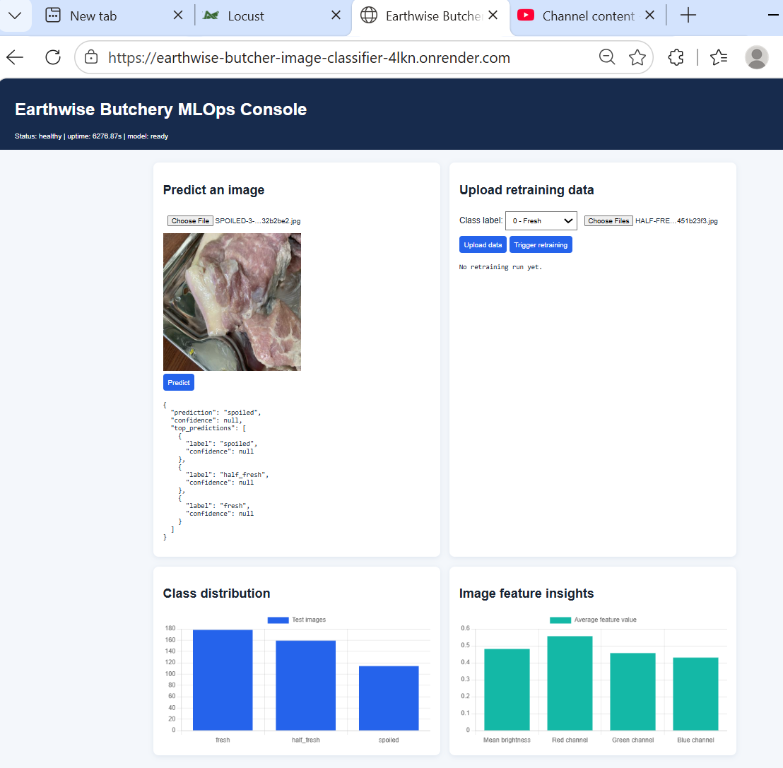
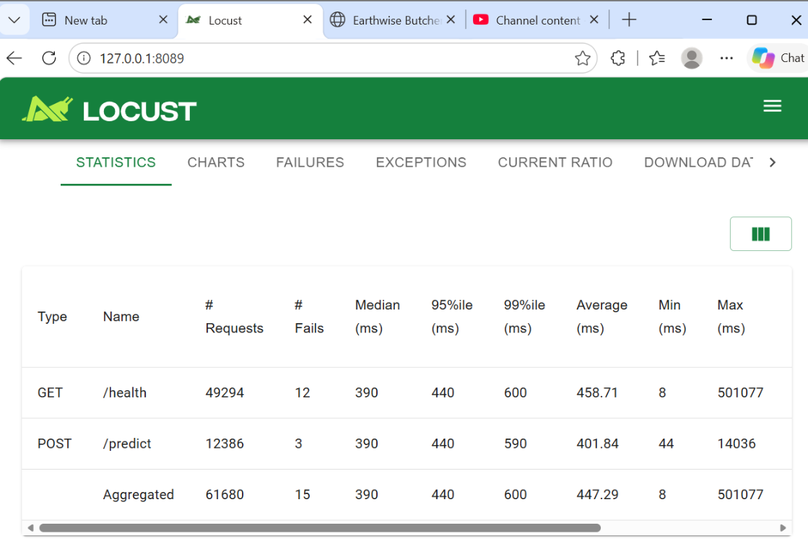

# Earthwise Butchery Meat Freshness MLOps Pipeline

## Project links

- [Project notebook in Google Colab](https://colab.research.google.com/drive/1LNNcI4cIXyVIlMNjb3M-IYDgG_wcydWJ?usp=sharing)
- [Video presentation](https://youtu.be/CTTNlFhVJcY)
- [Live application](https://earthwise-butcher-image-classifier-4lkn.onrender.com/)

## Screenshots

### Application prediction

The deployed application accepts an image and displays its predicted dataset label.



### Locust load test

Locust load-test snapshot targeting the Render application. At capture, the `/predict` row showed 12,386 requests, 3 failures, 390 ms median response time, and 440 ms 95th-percentile response time. Results are specific to this run.



## Project overview

This image-classification project predicts one of three visual labels for a meat photo: fresh, half-fresh, or spoiled. It uses non-tabular image data. The labels come from the downloaded Meat Freshness dataset; they are not a reliable food-safety assessment.

The project demonstrates an end-to-end machine-learning workflow: prepare and inspect labelled images, train and evaluate a classifier, serve predictions through a web API, and exercise the service with load tests. It is an educational MLOps prototype, not a food inspection system.

- Problem and input: classify a supplied meat image into one of the dataset's three labels: `fresh`, `half_fresh`, or `spoiled`.
- Approach: correct image orientation, convert to RGB, resize and normalize; represent each image with low-resolution RGB pixels and color histograms; train a standardized SGD classifier with logistic loss. Three-fold stratified cross-validation selects regularization strength using macro-F1.
- Output and use: receive a predicted dataset label, confidence, and ranked class probabilities from the web app or `/predict` API. The app also supports labelled image uploads and incremental retraining.
- Evaluation: measure performance on the provided held-out validation split, with accuracy, balanced accuracy, macro-precision, macro-recall, macro-F1, and a confusion matrix. The reported scores describe this dataset split only.
- Limitations: image predictions can be wrong and do not establish freshness, spoilage, or food safety. Do not use the model to decide whether food is safe to eat.

## Dataset

The project uses the [Meat Freshness Image Dataset](https://www.kaggle.com/datasets/vinayakshanawad/meat-freshness-image-dataset). Its dataset README describes 2,266 images with Fresh, Half-Fresh, and Spoiled labels. Kaggle lists the dataset as CC0. Keep the dataset attribution and licence information with coursework submissions.

The downloaded Roboflow export contains flat `train/` and `valid/` folders with `_classes.csv` files. The import script reads those CSV labels, creates class subfolders, and retains the supplied split: `train/` is used for model selection and training, while `valid/` becomes the held-out evaluation folder `test/`.

Verified source counts:

| Split | Fresh | Half-Fresh | Spoiled | Total |
|---|---:|---:|---:|---:|
| Train | 675 | 630 | 510 | 1,815 |
| Validation / held-out evaluation | 178 | 159 | 114 | 451 |
| Total | 853 | 789 | 624 | 2,266 |

The trained model scored 83.59% accuracy and 83.77% macro-F1 on the supplied 451-image validation split (balanced accuracy 83.08%, macro-precision 84.98%, macro-recall 83.08%). These are results on this dataset split, not evidence of real-world generalization.

These are dataset labels, not evidence that food is safe to eat. Do not use this model to make food-safety decisions.

## Install

```powershell
git clone https://github.com/kudakwashechikovo17/kudakwashe-mlops-classification-pipeline.git
cd kudakwashe-mlops-classification-pipeline
py -3.12 -m venv .venv
.venv\Scripts\Activate.ps1
python -m pip install --upgrade pip
python -m pip install -r requirements.txt
```

Python 3.11 is also supported by the project dependencies.

## Import and train

Download and extract the Kaggle dataset. From the repository root, import the extracted folder (adjust the path if you extracted it somewhere else):

```powershell
python scripts/import_freshness_dataset.py "C:\Users\pc\Downloads\archive (1)\Meat Freshness.v1-new-dataset.multiclass"
python scripts/train.py
```

The importer validates the CSV class labels and image files, then stores the prepared data under `data/meat_freshness/`. Dataset files are git-ignored and are not uploaded to GitHub. The provided validation split is held out from cross-validation and used for the reported evaluation. The evaluation is still limited to this dataset and is not a real-world food-safety test.

The model applies EXIF orientation, RGB conversion, resizing, and normalization. It combines low-resolution RGB pixels and color histograms, then trains a standardized logistic-loss SGD classifier. A three-fold stratified grid search selects regularization strength using macro-F1. The model, class names, and measured metrics are saved under `models/`.

The importer will not overwrite existing `data/meat_freshness/train/` or `test/` folders. Preserve or move an existing import before importing again.

## Notebook

Open the [project notebook in Google Colab](https://colab.research.google.com/drive/1LNNcI4cIXyVIlMNjb3M-IYDgG_wcydWJ?usp=sharing) for the full walkthrough of data acquisition and preprocessing, image insights, model optimization, held-out evaluation, single-image prediction, retraining, and deployment. To run the repository copy locally after importing the dataset:

```powershell
jupyter notebook notebook/project_name.ipynb
```

The notebook covers data setup, preprocessing, image insights, hyperparameter tuning, metrics, a confusion matrix, and prediction on a held-out image. In Colab, upload a ZIP of the extracted dataset when prompted. Colab requires the updated notebook and code from this repository; its runtime storage is temporary.

## Run the API

```powershell
uvicorn app.main:app --reload --host 0.0.0.0 --port 8000
```

Open `http://127.0.0.1:8000` for the UI, `/docs` for Swagger, `/health` for service status, `/metrics` for evaluation metrics, and `/visualizations` for the held-out class counts and image insights.

The UI supports image prediction, labelled uploads, and incremental retraining. Label new uploads using the dataset's freshness categories only when the label is known. Uploaded photos and the SQLite registry are stored under `data/meat_freshness/`.

## Interactive Locust dashboard for a presentation

You can run the model and Locust locally without Docker. Open two PowerShell terminals in the repository folder. In the first terminal, start the API:

```powershell
python -m uvicorn app.main:app --host 127.0.0.1 --port 8000
```

In the second terminal, start Locust's web interface:

```powershell
python -m locust -f locustfile.py --host http://127.0.0.1:8000 --web-host 127.0.0.1 --web-port 8089
```

Open `http://127.0.0.1:8089` for the Locust dashboard and `http://127.0.0.1:8000` for the model UI. On the Locust start page, enter a peak user count (for example, `10`) and spawn rate (for example, `2` users/second), keep the host as `http://127.0.0.1:8000`, and start the test. Use Advanced options to set a run time such as `30s`. The live statistics show request counts, failures, response times, and requests per second; use the `POST /predict` row to present model timings. The model UI lets you select an image and display its prediction response.

This local setup runs one API process. To compare one versus multiple API containers, use the Docker Compose instructions below with Docker Desktop running. Stop the local services with Ctrl+C in their respective terminals.

## Docker and Render

The Compose setup puts an Nginx proxy in front of one or more API containers. The proxy uses Docker DNS to discover the scaled API replicas and logs the selected upstream address.

Start one API container:

```powershell
docker compose up --build --scale api=1 -d
```

Scale to two API containers for a comparison:

```powershell
docker compose up --scale api=2 --force-recreate -d
docker compose ps
```

Run equivalent 30-second Locust tests at each scale, using the same workload and a spawn rate of 10 users per second. Install Locust in the active Python environment if needed. Example for 10 users on one API container:

```powershell
python -m locust -f locustfile.py --host http://127.0.0.1:8000 --headless -u 10 -r 10 --run-time 30s --html results/locust/freshness-1-container-10-users.html --csv results/locust/freshness-1-container-10-users
```

Repeat with `-u 50` and `-u 100`, keeping `-r 10` and `--run-time 30s`; change the report name to match the user count. Repeat after scaling to two API containers, changing `freshness-1-container` to `freshness-2-container` in the report names. Check `docker compose logs proxy` to verify traffic reached both API replicas.

The Locust workload sends four `/health` requests for each `/predict` request. In the HTML report and `*_stats.csv`, use the `POST /predict` row when reporting model latency; the `Aggregated` row combines health checks and predictions. To display a prediction response, submit an image to the running API:

```powershell
curl.exe -F "file=@C:\path\to\image.jpg" http://127.0.0.1:8000/predict
```

The JSON response contains `prediction`, `confidence`, and `top_predictions`. Replace the example path with an image file on your machine.

Stop the containers after testing:

```powershell
docker compose down
```

The Docker image contains the tracked model but not the ignored dataset. Push updated source and model files to GitHub before rebuilding or redeploying if the public service should use this newly trained freshness model. Render's free service does not provide persistent local storage; uploaded files and retraining changes may be lost after restarts or spin-downs.

## Load-test results and submission notes

The following local comparison uses only the `POST /predict` row from the Locust CSV reports. Runs used the freshness model, Locust 2.37.10, the workload from `locustfile.py`, a 30-second duration, and a spawn rate of 10 users/second. All prediction requests completed with zero failures. Measurements are machine-specific; do not treat them as Render performance results.

| API containers | Users | Prediction requests | Failures | Average (ms) | Median (ms) | P95 (ms) | Predictions/s |
| ---: | ---: | ---: | ---: | ---: | ---: | ---: | ---: |
| 1 | 10 | 136 | 0 | 134.2 | 85 | 180 | 5.15 |
| 1 | 50 | 442 | 0 | 228.7 | 170 | 480 | 16.20 |
| 1 | 100 | 500 | 0 | 577.3 | 620 | 900 | 18.22 |
| 2 | 10 | 174 | 0 | 108.3 | 93 | 250 | 6.42 |
| 2 | 50 | 692 | 0 | 93.6 | 87 | 170 | 25.07 |
| 2 | 100 | 605 | 0 | 317.5 | 170 | 820 | 22.05 |

HTML and CSV details for each run are saved under `results/locust/` with filenames beginning `freshness-1-container-` or `freshness-2-container-`. The proxy logs showed requests distributed across both API container IPs in the two-container test. These results show improved throughput at 50 and 100 users in this run, but do not imply linear scaling.

The classifier's outputs must be described as image-based dataset labels, not as confirmation that meat is fresh, spoiled, or safe to consume. Include the dataset source/licence, measured evaluation results, verified deployment URL, actual load-test results, and demo link in the final submission.
